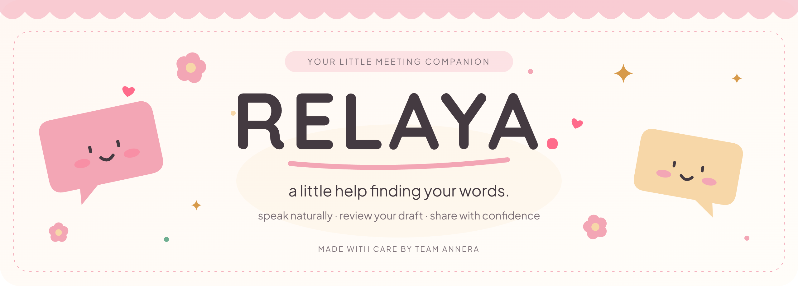

<p align="center">
  
</p>



<p align="center">
  <strong>Your thoughts deserve to be heard. Let’s find the words together. ♡</strong>
</p>

<p align="center">
  <a href="#-the-relaya-showcase">🌷 the showcase</a> &nbsp;·&nbsp;
  <a href="#-a-little-about-relaya">meet relaya</a> &nbsp;·&nbsp;
  <a href="#-make-yourself-at-home">set it up</a>
</p>

<p align="center"><sub>made by Team ANNERA</sub></p>


## 🌸 A little about Relaya

Speak in the language that feels like you. Relaya helps turn your thoughts into clear English for your next meeting. Read your draft, make it yours, and choose how to share it.

<p align="center">
  <strong>Tagalog · Bisaya · English · Japanese · Mandarin · Spanish</strong><br />
  <sub>your words in - a little clarity - English out</sub>
</p>

<p align="center">
  
  &nbsp;
  
</p>

<p align="center">✦ casual or professional &nbsp; ✦ familiar names remembered &nbsp; ✦ every draft is yours to review</p>


## 🌷 The Relaya showcase

<p align="center">
  <strong>A little peek into our world. ♡</strong><br />
  Take a look around, meet Relaya, and see what we’ve been making.
</p>

<p align="center">
  <a href="https://relaya-showcase.vercel.app/"><strong>🌸 step inside the showcase ↗</strong></a><br />
  <sub>made by Team ANNERA</sub>
</p>


## 🧺 Make yourself at home

A few small steps, then you’re ready. You’ll need **Git**, **Node.js 24**, and your own **Supabase** and **Groq** accounts.

### ① Bring Relaya home

Open a terminal and run:

```sh
npm install --global pnpm@9.15.9
git clone https://github.com/ralphchr/RELAYA.git
cd RELAYA
pnpm install
```

Keep this project folder open for the steps below.

<details>
<summary>🍰 Just looking around? Try the key-free preview.</summary>

```sh
pnpm --filter @relaya/web dev
```

Open [Relaya locally](http://127.0.0.1:5173), select **Sign up / Login → Continue as Guest**, and have a look around. The preview uses sample sentences and a pretend meeting agent.

Continue below when you’re ready to try your own voice.

</details>

### ② Gather your keys

- **[Supabase](https://supabase.com/dashboard):** create a project, then copy its **Project URL**, **publishable / anon key**, and legacy **service_role key** from the project’s API settings.
- **[Groq](https://console.groq.com/keys):** create your own API key.
- **[Gemini](https://aistudio.google.com/apikey)** *(optional): add a key for the preferred Bisaya speech option.

### ③ Prepare your little workspace

In your Supabase project:

1. Open **SQL Editor**. Run the files in [database/migrations](database/migrations) in order, from `0001` through `0012`. Skip any you’ve already applied.
2. Enable **Email** sign-in.
3. Under **Authentication → URL Configuration**, set **Site URL** to `http://127.0.0.1:5173` and add these redirect URLs:

   ```text
   http://127.0.0.1:5173/auth/callback
   http://127.0.0.1:5173/auth/callback?next=/email-confirmed
   ```

### ④ Pop your keys into place

Create these two files and replace the `YOUR_...` placeholders with your own values. Use the same Supabase project for both.

<details>
<summary>🌷 Open for the two files to copy</summary>

**`frontend/.env.local`**

```dotenv
VITE_SUPABASE_URL=https://YOUR_PROJECT_REF.supabase.co
VITE_SUPABASE_ANON_KEY=YOUR_PUBLISHABLE_OR_ANON_KEY
VITE_API_URL=http://127.0.0.1:8787/api
```

**`backend/.env.local`**

```dotenv
SUPABASE_URL=https://YOUR_PROJECT_REF.supabase.co
SUPABASE_SERVICE_ROLE_KEY=YOUR_LEGACY_SERVICE_ROLE_KEY
GROQ_API_KEY=YOUR_GROQ_KEY
ALLOWED_ORIGINS=http://127.0.0.1:5173,http://localhost:5173
STT_PROVIDER=auto
GEMINI_API_KEY=
```

Have a Gemini key? Add it after `GEMINI_API_KEY=`. Otherwise, leave it blank.

Keep private keys in `backend/.env.local`. Keep both files private, and restart the app after changing them.

</details>

### ⑤ Say hello

Open **two terminals** in the project folder. Leave both running.

**In the first:**

```sh
pnpm --filter @relaya/backend dev
```

**In the second:**

```sh
pnpm --filter @relaya/web dev
```

Open **[Relaya locally](http://127.0.0.1:5173)**, create an account, and sign in. Confirm your email if asked.

1. Choose **Say it yourself** and allow microphone access.
2. Hold **Space** to speak, then release.
3. Read your English draft, make any edits, and share it when you’re ready. ♡

<details>
<summary>🧸 Want Relaya to speak in your meeting, too?</summary>

Follow the [Google Meet agent steps](docs/setup/LOCAL_SETUP.md#meet-agent) to connect the meeting companion. You’ll need Chrome and a separate Google account named **RELAYA AI**.

Once it’s ready, choose **Speak for me**, paste your Meet link, and admit Relaya to the call. Review each draft before approving it to speak.

</details>

<details>
<summary>🩹 A little help if something gets stuck</summary>

- **Seeing sample sentences?** Sign in with your account instead of Guest, then restart after adding your keys.
- **Can’t sign in?** Confirm your email and double-check the two redirect URLs in step ③.
- **No microphone?** Allow microphone access in your browser.
- **Still stuck?** The [full setup guide](docs/setup/LOCAL_SETUP.md) has a few more things to try.

</details>


<p align="center"><strong>📖 a few helpful bookmarks</strong></p>

<p align="center">
  <a href="https://relaya-showcase.vercel.app/">the showcase</a> &nbsp;·&nbsp;
  <a href="docs/setup/LOCAL_SETUP.md">setup help</a> &nbsp;·&nbsp;
  <a href="docs/setup/AUTH_SETUP.md">sign-in help</a> &nbsp;·&nbsp;
  <a href="agent/README.md">meeting companion</a>
</p>


<p align="center"><sub>mean it. control it. relay it. ♡</sub></p>
